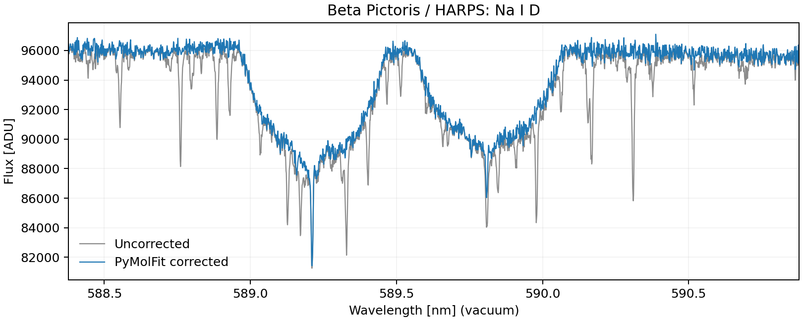
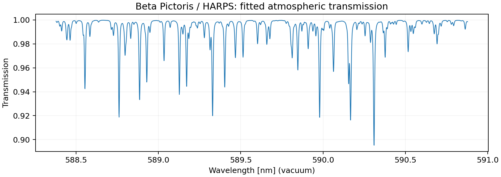

# Figure examples

First run [notebook 01](../user_guide/01_fits_correction.ipynb), which saves `docs/user_guide/outputs/beta_pic_fits.ecsv`. Then, from the repository root:

```sh
python docs/figure_examples/plot_nad_correction.py
python docs/figure_examples/plot_transmission.py
```

Each script opens a figure and saves one PNG beside itself. Add `--no-show` to save without opening a window. They reuse the fitted product without repeating the correction or running Molecfit. Both curves in the before/after figure retain their original common flux scale; there is no independent renormalisation.

To plot a different full product, pass its path as the first argument. The Na D example shows the available coverage within 588--591 nm; the transmission example displays the product's available coverage. These small scripts target the continuous HARPS data, not plots that connect separate detector orders.





## Publication comparisons

The separate `paper_validation/` directory retains only the three figure-producing comparison workflows and their dependencies:

| Script | Figure |
| --- | --- |
| `paper_validation/beta_pic_regions/compare_regions.py` | `regions_mosaic.png`: Beta Pictoris/AU Mic Na D comparisons. |
| `paper_validation/beta_pic_full/compare_full.py` | `mean_absolute_deviation.png`: HARPS transmission and relative difference (historical filename retained). |
| `paper_validation/crires_comparison/compare_crires.py` | `crires_comparison.png`: CRIRES+ transmission and relative difference. |

Those scientific comparisons retain their fitted inputs, protocols and Molecfit dependencies; they are not required by the user-guide examples. The local Overleaf source is not edited by this documentation cleanup.
